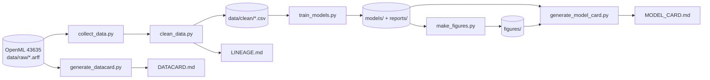

# Probabilité de victoire à 15 minutes : parties Diamant de League of Legends

Projet de data science (EPSI, 2026-2027) sur le jeu de données
[OpenML 43635](https://www.openml.org/search?type=data&status=active&id=43635) : 48 651 parties classées
Diamant (serveur NA1), décrites à la 15e minute. Objectif : estimer, à 15:00, la probabilité de victoire
de l'équipe bleue, avec uniquement des informations disponibles en direct (overlay de stream, analyse de VOD).

## Démarrage rapide

```bash
git clone https://github.com/Toastaspiring/AnalyseLeagueGame15.git
cd AnalyseLeagueGame15
python -m venv .venv
# Windows (PowerShell) : .venv\Scripts\Activate.ps1    macOS / Linux : source .venv/bin/activate
pip install -r requirements.txt
python run_pipeline.py          # environ 5 minutes
```

Le guide pas à pas (Windows et macOS / Linux, vérifications, dépannage, exercice) est dans
`docs/Support_onboarding.docx`. L'architecture, les données, le modèle et les scripts sont décrits dans
`docs/Documentation_technique.docx`.

## Architecture



| Étape | Commande | Produit |
|---|---|---|
| Collecte | `python collect_data.py` | vérifie `data/raw/dataset_43635.arff` (MD5 publié par OpenML) |
| Traitement | `python clean_data.py` | `data/clean/lol_diamond_15min_clean.csv`, `LINEAGE.md` |
| Entraînement | `python train_models.py` | `models/`, `reports/metrics.json`, `reports/predictions_test.csv` |
| Graphes | `python make_figures.py` | `figures/*.png`, `figures/manifest.json` |
| Documentation | `python generate_datacard.py` puis `python generate_model_card.py` | `DATACARD.md`, `MODEL_CARD.md` |
| Tout | `python run_pipeline.py` (`--from <étape>`, `--only <étapes>`, `--list`) | l'ensemble |

## Contenu du dépôt

Le dépôt ne contient que le code, les textes rédigés à la main et les **données d'entrée** (`data/raw/`).
Tout le reste (dataset nettoyé, modèles, graphes, datacard, model card, lineage) est régénéré en local
par la chaîne : c'est ce qui garantit qu'un nouvel arrivant peut tout reproduire.

| Chemin | Rôle |
|---|---|
| `common.py` | Définitions partagées : chemins, variables du modèle, découpage apprentissage / test |
| `collect_data.py`, `clean_data.py`, `train_models.py`, `make_figures.py` | Étapes de la chaîne |
| `generate_datacard.py`, `generate_model_card.py` | Génération de la documentation |
| `run_pipeline.py` | Exécute toute la chaîne |
| `datacard_header.md`, `datacard_config.json` | Parties rédigées à la main de la datacard |
| `model_card_header.md`, `model_card_config.json` | Parties rédigées à la main de la model card |
| `exploration_lol_diamond_15min.ipynb` | Exploration des données (`pip install -r requirements-notebook.txt`) |
| `docs/` | Modèle Word, documentation technique, support d'onboarding |
| `data/raw/` | Données d'entrée : fichier ARFF d'OpenML et ses métadonnées |
